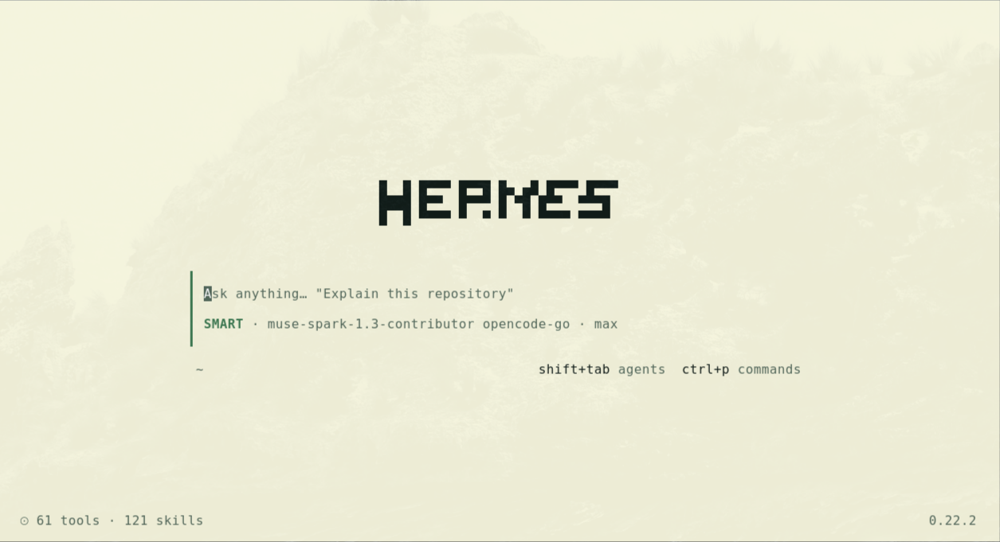

# openhermes

The OpenCode look on Hermes Agent. An opt-in layout for the Ink TUI (`hermes --tui`) that faithfully replicates the appearance and behavior of OpenCode 2, while keeping 100% of the Hermes tools, memory, gateway, and skills. Nothing in the classic CLI changes.

Community project, not affiliated with SST (OpenCode) or Nous Research (Hermes Agent).



## Apply in 5 minutes (recommended)

Everything is pre-built: new files, one patch, 66 skins, and scripts that check each step. Your slash commands, models, sessions, skills, and plugins are read live from your own setup — nothing to migrate.

Requirements: a Hermes Agent checkout at **0.22.2** (`d923a5eb48`), Node with installed workspaces (`node_modules` present — true if `hermes --tui` already runs), Python 3.

```bash
git clone https://github.com/<you>/openhermes
cd openhermes
bash scripts/apply.sh            # or: bash scripts/apply.sh --force /path/to/hermes-agent
```

What it does, in order:

1. Copies the 5 new files (`files/`: palette, surfaces, pixel font, tests).
2. Applies `patches/001-fases-1-4.patch` (all edits to existing files).
3. Validates Python syntax, TypeScript, ESLint, and the full UI test suite.
4. Rebuilds the TUI bundle (`ui-tui/dist`).
5. Installs the 66 skins into your Hermes home and validates them.

Then enable it:

```bash
hermes config set display.layout opencode
hermes config set display.skin oh-opencode   # optional; the TUI keeps its own theme after that
hermes --tui
```

Check health any time with `bash scripts/verify.sh`, roll back with `bash scripts/revert.sh`.

Never hand-edit `config.yaml` for any of this. Always use `hermes config set`.

## What's in this repo

| Path/file | What it is |
|---|---|
| `scripts/apply.sh` | One-shot apply (above) |
| `scripts/verify.sh` | Health checks: markers, typecheck, tests, skins |
| `scripts/revert.sh` | Undoes apply.sh (patch + new files; skins stay) |
| `files/` | The 5 new files, copied verbatim by apply.sh |
| `patches/` | Every edit to existing files, as one git patch |
| `themes/` | 66 ready-to-use skins for `~/.hermes/skins/`: the 33 real OpenCode 2.0.32 themes in dark (`oh-dracula.yaml`) and light (`oh-dracula-light.yaml`) modes, with values extracted from the official binary |
| `preview/` | Approved clickable preview of the full layout (single HTML file, open it in a browser) |
| `specs/layout.md` | Exact behavioral spec: every screen, every shortcut, every rule |
| `specs/mapping.md` | Every preview element mapped to the real Hermes system (file or command) |
| `SKILL.md` | Guided phase-by-phase build, for checkouts the patch doesn't fit |
| `scripts/` | Skin validator and preview server |

## Environment-specific things (nothing to do)

These come from the person's own setup at runtime — the port only reads them, never copies:

- slash commands, models, sessions/tabs, skills, plugins, MCP servers;
- tool counts and usage numbers in the footer;
- the person's own skins (untouched; the TUI theme lives in `display.tui_skin`, the desktop keeps `display.skin`).

## Build from scratch (alternative)

If the patch doesn't fit the checkout (different Hermes version), paste this into Hermes:

```
Read the openhermes repo's SKILL.md and run Phase 1 (skins + the
display.layout flag). Only move to the next phase once I approve the current one.
```

Or install the skill directly:

```bash
hermes skills install https://github.com/<you>/openhermes/blob/main/SKILL.md
```

## Verification (how to tell it worked)

1. `hermes config get display.layout` shows `opencode`
2. `hermes --tui` opens the clean centered home screen, with no tools panel
3. Ctrl+P opens Commands with the full menu before typing anything
4. Typing `theme` filters down to 1 item; Enter opens the 33 themes, starting at the current one
5. Shift+Tab cycles SMART, PLAN, and YOLO on the input box line
6. Typing `/` opens autocomplete with the Hermes slash commands
7. A new tab via `+` opens the clean home; once you type it becomes a conversation and `+` comes back
8. Changing the theme in the TUI does not change Hermes Desktop

## Themes

Extracted from the official OpenCode 2.0.32 binary (registry variable `ue` plus the `opencode` theme), with light and dark modes resolved per token: background, text, muted, accent, selection, agent, variant, panel, band, border, diffs, and syntax. OpenCode's `system` mode follows the terminal; on Hermes, switch between `oh-<name>` and `oh-<name>-light`, or pin Color mode to light/dark.

## Status

- HTML preview: approved, covered by 20 executable checks
- Skins: generated and validated (`scripts/validate_skins.py`), recognized by the real Hermes
- TUI port: implemented and verified (clean typecheck, 1633+ green tests, live smoke tests in the terminal); patch exported in `patches/001-fases-1-4.patch`
- Custom home-screen name supported (Ctrl+P → Change name)
- TUI theme is independent from Hermes Desktop (`display.tui_skin` vs `display.skin`)

## License

MIT. Theme colors belong to their original authors. `font8x8_basic` glyphs are public domain (Daniel Hepper).
